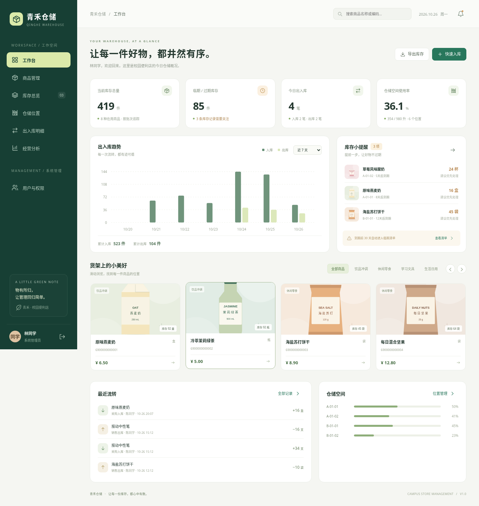

# 青禾仓储 · 校园便利店仓储管理系统

网页设计与网站建设分组作业，选题一「仓库管理系统」。完整前后端项目，包含双角色、照片轮播、商品批次、保质期、货架空间、出入库、模拟扫码和经营统计。

技术栈：**Python 3.11+ / Flask / SQLite / 原生 JavaScript / CSS**。不需要Node.js、MySQL或外部图片服务。电脑和手机均可使用，数据保存到本地数据库，刷新和重启后保留。

## 下载与界面预览

在本仓库页面点击 **Code → Download ZIP**，下载后解压即可得到完整项目文件夹。请先阅读 `先读我.txt`，再按下面步骤启动。

工作台效果：



[查看登录页面](docs/screenshots/login.png) · [查看手机页面](docs/screenshots/mobile.png) · [课程设计说明](docs/课程设计说明.md)

## 快速运行

在项目目录中创建虚拟环境：

```bash
python -m venv .venv
```

Windows：

```powershell
.venv\Scripts\python -m pip install -r requirements.txt
.venv\Scripts\python app.py
```

macOS / Linux：

```bash
.venv/bin/python -m pip install -r requirements.txt
.venv/bin/python app.py
```

也可运行 `start.bat`（Windows）或 `sh start.sh`（macOS/Linux）。终端输出本机访问地址，默认端口为 **5000**。首次启动创建数据库和演示数据，再次启动不会覆盖已有记录。

| 角色 | 用户名 | 初始密码 | 权限 |
| --- | --- | --- | --- |
| 管理员 | `admin` | `Admin123!` | 商品、分类、用户与权限、仓储和库存管理 |
| 仓储人员 | `staff` | `Staff123!` | 浏览、出入库、仓储位置维护、导出 |

点击左下角头像可修改自己的密码。管理员可新增成员、重置密码、停用账号或设置普通账号为只读。上述账号用于课程演示。

## 功能与作业要求对应

| 作业要求 | 实现位置 |
| --- | --- |
| 管理员维护物品详情、用户及权限表 | 商品管理、用户与权限 |
| 一般用户维护包装体积、位置及库存数量 | 入库表单、仓储位置、出入库登记 |
| 分类摆放、照片滑动翻页、聚焦放大 | 工作台滑动陈列、分类切换、详情多图切换 |
| 名称、尺寸、批次、生产日期、到期日期、照片 | 商品档案及批次库存；无保质期商品可留空到期日 |
| 货架空间表和剩余容量 | 仓储位置卡片、容量进度条 |
| 库存表、临期数量明细 | 库存总览、临期/过期/低库存筛选、CSV导出 |
| 销售管理、出入明细 | 销售金额、实际分配、操作人及时间流水 |
| 输入数字编码模拟扫码 | 登记顶部编码查询，例如 `6900000000001` |
| 空间不足后另找位置 | 入库自动拆分分配到多个有空间的位置 |
| 高频进出物品 | 经营分析，近7天、近30天或全部时间 |

演示商品使用本地插画和货架示意图，可上传实拍商品或摆放照片替换。每件商品最多8张图片，支持JPG、PNG、WebP，服务端验证并转为WebP。模拟扫码通过输入编码实现，不调用摄像头或实体扫码硬件。

## 业务规则

- 商品档案与批次分开保存。同一商品可有多个批次，同一批次可分布在多个位置。
- 商品尺寸以厘米记录，单件体积向上取整为cm³；位置容量以升录入。仓储人员可在入库时填写该批次的单件体积。修改商品尺寸不改变历史批次占用空间。
- 同一商品、同一批次的生产日期、到期日期和单件体积必须一致。
- 空间按「单件体积×数量」估算，不模拟三维装箱、承重或冷链调度。
- 入库先使用指定位置，再按位置编号分配到其他在用位置。可关闭自动分配。空间不足时包括新批次在内的整笔操作回滚。
- 出库可指定批次/位置，也可自动先到期先出；无保质期商品在有保质期商品之后按生产日期排序。
- 到期当天仍有效，次日起过期；过期商品仅允许报损，不能销售或领用。库存不足时整笔失败。
- 临期为到期前0～30天；低库存为总量不高于预警线。零库存商品仍保留在商品管理中。
- 有库存的商品和位置不能停用，位置容量不能缩减到已使用空间以下。
- 销售金额使用出库时保存的售价；以后调价不改变历史金额。未实现采购成本、真实收款、财务记账或AI预测。
- 流水保留历史，不提供直接删除和编辑；补货、退货和报损通过新流水登记。
- 后端逐次校验账号状态和权限。普通账号可分别授予出入库、位置维护权限，商品、分类和用户维护仅限管理员。

## 目录结构

```text
app.py                       # 启动入口
warehouse/
  __init__.py                # 应用工厂、配置、安全响应头
  api.py                     # 登录、权限、CRUD、库存事务、照片和导出
  db.py                      # 数据库连接和初始化
  schema.sql                 # 9张业务表及索引
  seed.py                    # 幂等演示数据初始化
templates/index.html         # 页面入口
static/app.js                # 七个页面、表单、图表和轮播
static/styles.css            # 响应式样式
static/images/               # 离线示例插画
tests/                       # 后端业务和并发测试
scripts/browser_smoke.py     # 临时数据库上的浏览器验证
docs/课程设计说明.md          # 数据库、分工及答辩流程
start.bat / start.sh          # 启动脚本
requirements*.txt            # 运行和测试依赖
instance/                    # 自动生成，Git忽略
  warehouse.sqlite3          # 数据库
  session.key                # 会话签名密钥
  uploads/                   # 上传照片
```

## 测试

使用虚拟环境内的Python执行：

```bash
python -m pip install -r requirements-dev.txt
python -m pytest -q
```

测试使用独立临时数据库，不影响日常数据。覆盖鉴权、CSRF、权限撤销、账号管理、商品和位置维护、图片校验、CSV、临期优先出库、库存不足、空间不足回滚及并发防超卖。

浏览器验证为可选开发工具：

```bash
python -m pip install -r requirements-browser.txt
python -m playwright install chromium
python scripts/browser_smoke.py
```

已有系统Chromium时优先使用它，也可设置 `CHROMIUM_EXECUTABLE` 指定路径。脚本自行启动临时服务，验证真实交互，将截图写入 `artifacts/`。

## 配置与备份

| 环境变量 | 默认值 | 用途 |
| --- | --- | --- |
| `HOST` | `127.0.0.1` | 监听地址；局域网演示可设为 `0.0.0.0` |
| `PORT` | `5000` | 服务端口 |
| `WAREHOUSE_SECRET_KEY` | 自动生成到 `instance/session.key` | 会话签名密钥 |
| `WAREHOUSE_HTTPS` | 关闭 | HTTPS部署时设为 `1` 开启Secure会话Cookie |

时间和库存日期统一采用北京时间。SQLite不需要数据库账号。

备份时停止服务，再备份整个 `instance/`，包含数据库、照片和会话密钥。恢复时放回同一路径，不要将真实数据和密钥提交到Git。重置演示数据时先备份，再将数据库文件改名，重启后自动新建演示库。

本项目面向课程作业和本地演示，默认使用Flask开发服务器。公开部署需另外配置生产WSGI服务、HTTPS、访问限流和备份策略。
