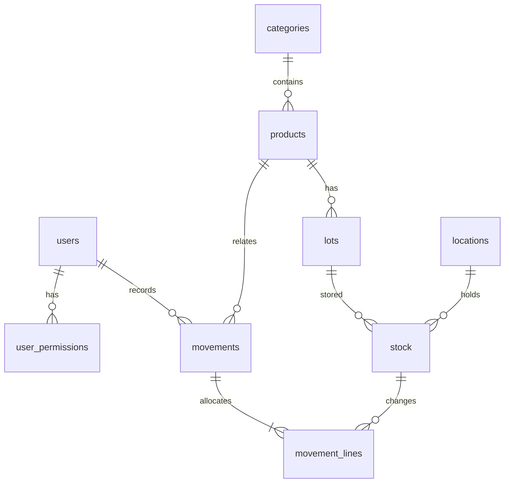

# 基于Web的校园便利店仓储管理系统设计与实现

## 一、选题与结构

校园便利店的食品和饮品需要追踪保质期，文具和日用品需要分类摆放。人工登记容易出现库存不一致、临期遗漏和位置不明。本系统统一维护商品、批次、位置和流水，面向小型门店的基础仓储管理。

采用浏览器—Flask服务—SQLite数据库三层结构，页面通过JSON接口读取和写入业务数据。前端无需构建工具，数据库自动初始化，所有示例图片均在本地。

## 二、角色与权限

| 操作 | 管理员 | 有相应权限的仓储人员 | 只读人员 |
| --- | --- | --- | --- |
| 浏览商品、库存、明细和分析 | ✓ | ✓ | ✓ |
| 导出库存CSV | ✓ | ✓ | ✓ |
| 商品、分类维护及照片上传 | ✓ | — | — |
| 入库、出库和批次体积登记 | ✓ | `stock.write` | — |
| 位置新增、编辑和停用 | ✓ | `locations.write` | — |
| 用户、密码重置和权限分配 | ✓ | — | — |
| 修改自己的密码 | ✓ | ✓ | ✓ |

后台接口逐次读取数据库中的角色、状态和权限。停用账号后，已有会话也不能继续访问。普通账号的两个写权限都不勾选时即为只读账号。管理员不可停用自己或移除自己的管理员身份。

## 三、功能模块

1. 工作台：当前库存、临期数量、今日流水、空间使用率、趋势图、滑动商品陈列和最近流转。
2. 商品管理：分类、编码、名称、尺寸、单位、售价、预警线、介绍和多张照片；支持停用和恢复。
3. 库存总览：按商品—批次—位置展示；支持分类、关键词、临期、过期、低库存筛选与CSV导出。
4. 仓储位置：区域、位置编号、容积、已用空间和数量，可新增、编辑、停用和恢复。
5. 出入库：采购及退货入库；销售、领用及报损出库；编码查询、批次分配与历史明细。
6. 经营分析：期间销售数量和金额、高频商品排行、分类库存分布。
7. 用户权限：新增账号、修改角色、停用账号、重置密码、分配操作权限。

## 四、数据库设计

系统共9张表，开启外键约束，并对数量和容积添加CHECK约束。

| 表 | 核心字段 | 用途 |
| --- | --- | --- |
| `users` | username、display_name、password_hash、role、active | 用户和角色 |
| `user_permissions` | user_id、permission | 操作权限 |
| `categories` | name | 商品分类 |
| `products` | sku、name、category_id、尺寸、price_cents、reorder_point、images_json、active | 商品详情 |
| `locations` | code、zone、capacity_cm3、active | 仓储空间 |
| `lots` | product_id、batch_no、production_date、expiry_date、unit_volume_cm3 | 商品批次 |
| `stock` | lot_id、location_id、quantity | 各位置的批次库存 |
| `movements` | reference、product_id、direction、reason、quantity、unit_price_cents、actor_id、created_at | 出入库总单 |
| `movement_lines` | movement_id、stock_id、quantity | 流水的批次及位置分配明细 |

同一商品与批次号组合唯一，同一批次与位置组合唯一。一批商品可分散到多个位置，每个位置有独立库存余额。

金额以整数「分」保存。出库流水保存发生时的商品售价，后续调价不改变历史金额。图片地址保存为JSON数组，每件商品最多8张。

## 五、核心算法

### 入库流程

输入编码 → 查询档案 → 输入批次、日期、体积和数量 → 指定位置 → 检查空间 → 分配库存 → 保存流水。

某位置可容纳数量：`floor((总容积 - 已用容积) / 单件体积)`。

先分配到指定位置，再按位置编号查找其他在用位置；关闭自动分配时只使用指定位置。空间不足时包括新批次记录在内的整笔操作回滚。

### 出库流程

输入编码 → 指定批次/位置或自动分配 → 输入数量和类型 → 检查可用库存 → 扣减库存 → 保存流水。

自动分配先到期先出，无保质期商品排在后面并按生产日期排序。销售和领用排除过期商品，报损允许处理过期商品。到期当天仍有效，次日起视为过期。

### 并发与一致性

使用SQLite的 `BEGIN IMMEDIATE` 在读取库存前获取写锁，将容量校验、库存增减和流水写入同一事务。后续请求会在前次提交后重新读取库存，避免同时出库导致负库存。

### 登录与数据保护

密码使用scrypt哈希；会话Cookie启用HttpOnly及SameSite；写入接口校验CSRF令牌；SQL使用参数绑定。照片先解析，再以服务端随机文件名重新编码保存；页面转义动态文本，CSV处理公式起始字符。

## 六、页面设计

深绿色侧栏与浅灰绿背景形成稳定布局，白色卡片承载统计和业务信息。商品陈列支持按钮翻页、横向滑动和分类查看，聚焦商品略微上移并放大图片。详情弹窗支持多图前后切换、圆点跳转及触屏滑动。

手机端折叠导航、调整卡片列数，表格在自身容器内横向滚动。弹窗支持Escape关闭、键盘焦点限制和返回原控件。

## 七、小组分工建议

| 成员 | 模块 | 文件 |
| --- | --- | --- |
| A | 页面布局、工作台、响应式 | `templates/index.html`、`static/styles.css`、`static/app.js` |
| B | 商品、分类、照片、账号权限 | `warehouse/api.py`对应接口和前端表单 |
| C | 数据库、批次、位置、库存事务 | `schema.sql`、`db.py`、`api.py` |
| D | 分析、测试、文档和汇报 | 经营分析、`tests/`、`scripts/browser_smoke.py`、本说明 |

人数不同可合并任务。每名成员都应能说明完整入库和出库流程。

## 八、答辩演示流程

1. 管理员登录，说明工作台各统计的数据来源。
2. 滑动商品陈列、切换分类，打开详情查看照片、批次和存放位置。
3. 查看临期与低库存清单，导出CSV。
4. 新增2L位置和单件体积1000cm³的商品。
5. 编码查询该商品，入库5件并开启自动分配，展示2件、3件分配到不同位置。
6. 销售出库3件，查看库存余额和销售流水。
7. 尝试超量出库，展示错误提示与库存未变化。
8. 切换普通账号，展示权限差异。
9. 查看高频流转排行，最后展示移动端布局。

## 九、验证与扩展

后端测试使用独立临时数据库，校验库存和流水余额、空间分配、失败回滚及两个并发请求争用库存。浏览器脚本验证导航、轮播、照片上传、新建商品和位置、模拟扫码、自动分配、超量出库提示、导出和手机端操作。

本项目实现编码输入模拟扫码与包装体积估算。实体扫码、温湿度监控、三维装箱、AI预测、多门店和财务功能可作为后续扩展，不包含真实支付。
